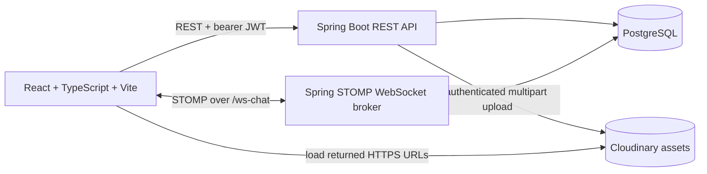
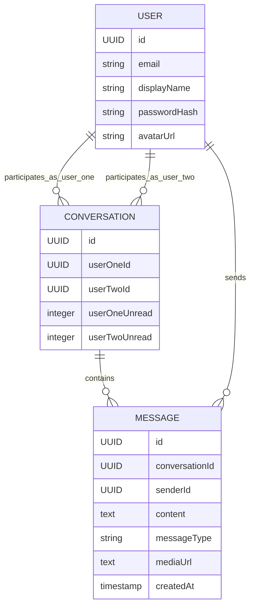
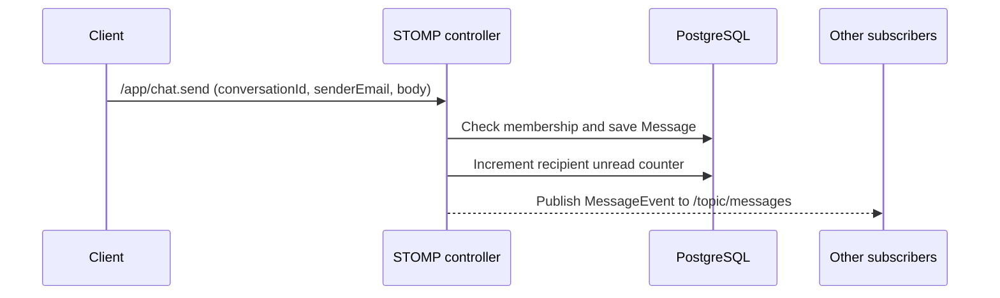

# Chatterbox Architecture

This document describes the current implementation: its components, responsibilities, data model, request flows, local setup, and known boundaries. It is intended as a code-oriented guide, not a deployment guarantee.

## 1. System at a glance

Chatterbox separates the app into three parts:

1. **React web client** — sign-in, conversation UI, Markdown and media display, profile editing, and WebSocket events.
2. **Spring Boot API** — authentication, conversation and profile REST endpoints, STOMP message handling, persistence, and Cloudinary integration.
3. **External/local services** — PostgreSQL stores users/conversations/messages; Cloudinary stores uploaded binary media and serves it over HTTPS. In local development PostgreSQL runs in Docker Compose.



### Main technology

- **Frontend:** React 18, TypeScript, Vite, STOMP.js, React Markdown with GFM, emoji-picker-react, MediaRecorder, lucide-react.
- **Backend:** Java 21 source target, Spring Boot 3.3, Spring MVC, Spring Security, Spring Data JPA, Spring WebSocket/STOMP, JJWT.
- **Storage:** PostgreSQL; H2 is a test dependency.
- **Media:** Cloudinary Java SDK. The app stores media URLs, not file bytes, in PostgreSQL.

## 2. Repository map

| Area | Responsibility |
| --- | --- |
| `frontend/src/main.tsx` | App/auth screens, workspace state, conversations, composer, uploads, Markdown/media rendering, profile photo cropping and save. |
| `frontend/src/styles.css` | Responsive layout, chat/media presentation, themes, composer and emoji-picker styling. |
| `frontend/src/main.tsx` `API_URL` | API base URL from `VITE_API_URL`, defaulting to `http://localhost:8080`. |
| `backend/src/main/java/com/chatterbox/chat/controller` | REST and STOMP entry points: authentication, users, conversations, media, health and live chat. |
| `backend/src/main/java/com/chatterbox/chat/service` | Authentication and Cloudinary upload behavior. |
| `backend/src/main/java/com/chatterbox/chat/security` | JWT issue/parse and HTTP bearer-token filter. |
| `backend/src/main/java/com/chatterbox/chat/entity` | JPA entities for `User`, `Conversation`, and `Message`. |
| `backend/src/main/java/com/chatterbox/chat/repository` | Spring Data database access. |
| `backend/src/main/java/com/chatterbox/chat/config` | HTTP security, CORS, and STOMP broker configuration. |
| `backend/src/main/resources/application.yml` | Server, multipart, PostgreSQL, and Cloudinary configuration. Also imports optional `.env` files. |
| `docker-compose.yml` | Local PostgreSQL service and named data volume. |
| `start.sh` | Starts Docker PostgreSQL, checks/restarts the local API as needed, then starts Vite. |
| `.github/workflows/ci.yml` | Frontend production build and backend Maven test lifecycle on pushes and pull requests. |

## 3. Frontend responsibilities

The Vite app mounts a single React application from `frontend/src/main.tsx`.

- **Authentication:** register and login use REST. The returned user and JWT are held in `localStorage` (`chatterbox_user` and `chatterbox_token`). Signing out clears local storage.
- **Workspace:** fetches the user's conversations, searches users by email, loads a conversation's message history, and tracks the active conversation, drafts, unread counts and UI settings in React state.
- **Conversation view:** text is rendered with `react-markdown` and `remark-gfm`. Media is chosen based on message type and URL extension, then shown as image preview, audio/video controls, or a file link. Media failure has a fallback link/card.
- **Composer:** supports multiline Markdown, file/image attachments, emoji picker and browser voice recording. Voice data is recorded as WebM and enters the same upload path as other files.
- **Profile photos:** the selected image is cropped client-side to a JPEG data URL. When saving, it is converted to a file, uploaded through the media API, and the returned URL is saved as the user's avatar URL.
- **Live events:** STOMP receives messages, typing updates and presence changes. The client de-duplicates live messages by ID and updates the relevant conversation.

## 4. Backend responsibilities

The Spring application is started by `ChatterboxApplication`.

- **Controllers** translate HTTP and STOMP requests into service/repository work.
- **Services** contain login/JWT issuance and Cloudinary media upload behavior.
- **Repositories** load and persist the JPA entities.
- **Security configuration** is stateless for HTTP, disables CSRF, applies CORS, registers the JWT filter in the Spring Security chain, and permits the media controller to validate the upload token itself. The media route accepts the bearer token in the Authorization header or multipart `token` field.
- **WebSocket configuration** exposes `/ws-chat`, maps `/app` destinations to controller methods, and enables in-memory `/topic` and `/queue` destinations.

## 5. Persistent data model



- Passwords are stored as BCrypt hashes; passwords are not returned to the client.
- `avatarUrl` is nullable and holds the Cloudinary URL when the user has a photo.
- Messages hold text/Markdown in `content`, a `messageType` such as `TEXT`, `IMAGE`, `VOICE`, `AUDIO`, `VIDEO` or `FILE`, and an optional `mediaUrl`.
- Conversation unread counters are maintained per participant. Marking a conversation read clears the caller's counter.
- JPA currently uses `ddl-auto: update`; there is no separate migration tool configured.

## 6. Authentication and authorization

### HTTP authentication

1. `/api/v1/auth/register` or `/api/v1/auth/login` validates credentials.
2. The API returns a signed JWT with the email as subject; its lifetime is 24 hours.
3. The browser stores it in local storage and sends it as `Authorization: Bearer …` on protected REST requests.
4. `JwtAuthenticationFilter` parses the bearer token and adds the email to the Spring Security context. Invalid/expired tokens return 401.
5. The media upload route is an exception to the normal filter path because of multipart handling. Its controller parses the submitted bearer token directly before permitting the upload.

### Important current WebSocket boundary

The STOMP endpoint currently allows origins with `*`, and the WebSocket controller accepts a `senderEmail` supplied in the STOMP payload. It performs conversation membership checks, but STOMP `CONNECT` is **not currently authenticated with the HTTP JWT**. Do not treat the WebSocket path as having the same identity guarantees as the protected REST API; production use should add authenticated STOMP principals and stricter origin rules.

## 7. Message and media flows

### Text message



Text body is saved in PostgreSQL. The frontend renders it as Markdown. Typing events use `/app/chat.typing` and `/topic/typing`; they are transient and are not stored.

The app also has REST endpoints to list/create conversations, list messages and mark a conversation read. The active UI currently uses STOMP to send chat messages; the REST send method exists as an alternate API path.

### Attachments and voice notes

```mermaid
sequenceDiagram
    participant C as Client
    participant A as Media API
    participant Cloud as Cloudinary
    participant W as STOMP controller
    participant D as PostgreSQL
    C->>C: Select file or record WebM voice note
    C->>A: POST /api/v1/media/upload (multipart file + JWT)
    A->>A: Validate signed JWT and file
    A->>Cloud: Upload to chatterbox folder (resource_type=auto)
    Cloud-->>A: secure_url
    A-->>C: URL and original name
    C->>W: /app/chat.send with body, type and mediaUrl
    W->>D: Save message and URL; update unread count
    W-->>C: Publish MessageEvent to /topic/messages
```

- The upload is limited to 25 MB in the browser and Spring multipart configuration.
- Cloudinary credentials are server-only. The browser never receives the API secret.
- Cloudinary returns an HTTPS `secure_url`; that URL is put in the message event and stored in the `mediaUrl` column.
- Browsers load media directly from the returned Cloudinary URL.
- If an upload succeeds but the subsequent chat send fails, the Cloudinary asset may remain unused; cleanup of orphan assets is not implemented.

### Profile-photo update

1. User selects and crops a local image in the browser.
2. Saving the profile uploads the cropped JPEG through the same authenticated Cloudinary media route.
3. The client sends `PATCH /api/v1/users/me` with display name and returned `avatarUrl`.
4. The server updates the user row and returns the updated user. The client updates local state and publishes a presence event so connected peers can refresh the displayed avatar/name.

## 8. Implemented API and STOMP surface

### REST

| Method | Route | Purpose |
| --- | --- | --- |
| `GET` | `/api/v1/health` | Health check and media/auth capability marker. |
| `POST` | `/api/v1/auth/register` | Create a user and return JWT/user. |
| `POST` | `/api/v1/auth/login` | Verify credentials and return JWT/user. |
| `GET` | `/api/v1/users/search?email=…` | Return up to eight matching users other than the caller. Requires JWT. |
| `PATCH` | `/api/v1/users/me` | Update display name and avatar URL. Requires JWT. |
| `GET` | `/api/v1/conversations` | List conversations and unread counts for caller. Requires JWT. |
| `POST` | `/api/v1/conversations` | Create/find a conversation with another user. Requires JWT. |
| `GET` | `/api/v1/conversations/{id}/messages` | Get ordered history after membership check. Requires JWT. |
| `POST` | `/api/v1/conversations/{id}/read` | Clear caller unread count. Requires JWT. |
| `POST` | `/api/v1/conversations/{id}/messages` | Persist a message through REST. Requires JWT. |
| `POST` | `/api/v1/media/upload` | Validate JWT, upload multipart media to Cloudinary and return URL/name. |

### STOMP

- WebSocket handshake endpoint: `/ws-chat`
- Client sends: `/app/chat.send`, `/app/chat.typing`, `/app/presence`
- Current client subscriptions: `/topic/messages`, `/topic/typing`, `/topic/presence`
- Message events are also published to `/topic/conversations/{id}/messages`; typing events to `/topic/conversations/{id}/typing`.
- The simple broker enables `/topic`, `/queue`, and `/user`, but the current client uses the global topic subscriptions above. Do not assume user-specific queue subscriptions are actively used.

## 9. Configuration and secrets

### Local setup

1. Copy `.env.example` to root `.env`.
2. Set `CLOUDINARY_CLOUD_NAME`, `CLOUDINARY_API_KEY`, and `CLOUDINARY_API_SECRET` using Cloudinary credentials with asset-create/upload permission.
3. Start Docker Engine, then run `./start.sh` from the repository root.
4. Open the exact frontend URL Vite prints. If 5173 is occupied, Vite selects another port.

The backend imports optional `.env` files from its working directory and the repository root. Environment variables supplied by the host take precedence. The root `.env` is ignored by Git and must never be committed. Never put Cloudinary's API secret in frontend variables, `VITE_*` settings, browser code or public GitHub files.

Other backend environment variables include `DATABASE_URL`, `DATABASE_USERNAME`, `DATABASE_PASSWORD`, `PORT`, and `CHATTERBOX_JWT_SECRET`. The local database defaults are for development only. Use host/service environment settings for deployments.

### Runtime/deployment shape

- Host the frontend as static assets on a service such as Vercel or Netlify.
- Host the Spring backend separately on a Java-capable host and configure its database and Cloudinary secrets there.
- Use hosted PostgreSQL (for example Neon or Supabase) and Cloudinary as media storage.
- GitHub Pages can publish the static frontend only; it does not run this Spring backend. GitHub Actions secrets are useful only if a deployment workflow intentionally forwards them to the backend host.
- Point the deployed frontend's `VITE_API_URL` at the deployed API. Configure backend CORS for the actual deployed frontend origin before production; current CORS patterns are local-development origins.

## 10. CI and validation

GitHub Actions currently runs on push and pull request:

- Frontend job: Node 20, `npm ci`, `npm run build`.
- Backend job: Java 21, `mvn -B test` (runs both the unit and API integration tests below).

Backend tests currently include:

- `AuthServiceTest`: unit tests for registration normalization/password hashing, duplicate registration rejection, successful login, and invalid-password rejection.
- `AuthApiIntegrationTest`: MockMvc API tests backed by an isolated H2 database for registration/JWT issuance, authenticated and unauthenticated protected requests, invalid login, and profile updates.

Keep `mvn -B test` in CI and add tests alongside new service/controller behavior. Cloudinary live uploads are not part of CI because CI must not need production credentials; media configuration/error behavior should be tested with a mocked provider boundary instead.

## 11. Current constraints and follow-up areas

- STOMP has no JWT-authenticated principal yet, and origin policy is permissive; harden before exposing publicly.
- HTTP CORS currently permits localhost/127.0.0.1 development origins only.
- Message edit/delete routes appear in the main README route list but are not implemented by a controller in the current backend source.
- Old locally stored `/media/...` URLs are not migrated to Cloudinary. Re-upload old assets if their local files are no longer available.
- The Cloudinary API key needs create/upload permission; a successful credential ping alone does not prove asset-creation access.
- `start.sh` starts PostgreSQL and the backend, then keeps Vite in the foreground. Ctrl+C stops the launcher-managed backend; if a previous process owns ports, inspect/stop that development server before restarting.
